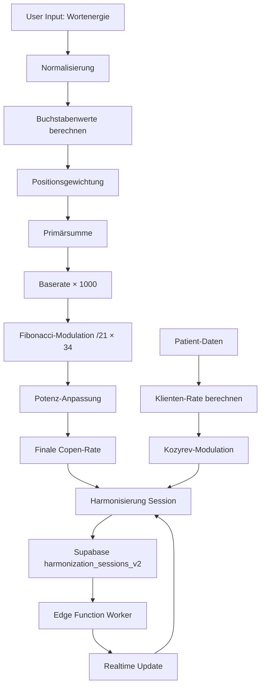

# Bruce Copen Algorithmus Visualisierung V2 - Wiederherstellungspunkt (Aktueller Stand)

## Dokumentstatus
- **Version**: 2.1 (Aktuell)
- **Stand**: 2025-10-28
- **Autor**: AI-Assistent
- **Zweck**: Vollständige Dokumentation aller Features, Algorithmen und Implementierungsdetails

---

## 📋 Inhaltsverzeichnis

1. [Überblick](#überblick)
2. [Architektur](#architektur)
3. [Komponenten-Details](#komponenten-details)
4. [Datenstrukturen](#datenstrukturen)
5. [Algorithmen](#algorithmen)
6. [Cloud-Integration](#cloud-integration)
7. [Features & Funktionalitäten](#features--funktionalitäten)
8. [Standard-Werte](#standard-werte)
9. [Export-Funktionen](#export-funktionen)
10. [Worker-System](#worker-system)
11. [UI/UX-Spezifikationen](#uiux-spezifikationen)
12. [Code-Referenzen](#code-referenzen)
13. [Wiederherstellungs-Checkliste](#wiederherstellungs-checkliste)
14. [Changelog](#changelog)

---

## 🎯 Überblick

Das **Bruce Copen Algorithmus Visualisierung V2 System** ist eine vollständig cloud-synchronisierte Anwendung zur Berechnung, Verwaltung und Harmonisierung von Copen-Raten basierend auf Wortenergien und Klientendaten.

### Hauptfunktionen

1. **Ratengenerator mit Auto-Potenz-Projektion**
   - Intelligente Berechnung der optimalen Potenz basierend auf Klienten- und Wortdaten
   - Support für Standard-Potenzen (D, C, LM, M) und F-Spektren (F1, F2, F3)
   - Kozyrev-erweiterte Modulation mit Alters- und Ortsenergien

2. **Parallele Harmonisierungs-Sessions (Cloud-Sync)**
   - Unbegrenzte gleichzeitige Harmonisierungen pro Patient
   - Echtzeit-Synchronisation via Supabase
   - Impuls/Pausen-Modus Support
   - Dauersendungs-Modus

3. **Datenbank-Analyse mit Fokus-Funktion**
   - Import von Wort-Datenbanken (CSV/TXT)
   - **Fokus-Wort Feature**: Priorisierte Analyse eines spezifischen Wortes
   - Automatische Potenz-Zahlen zu Worten Konvertierung (D6 → Dsechs)
   - Resonanz-Analyse mit 13 Ebenen
   - Export zu Archiv oder Harmonisierungen

4. **Harmonisierungs-Archiv (Cloud)**
   - Alle abgeschlossenen Sessions werden archiviert
   - Reaktivierungs-Funktion mit anpassbaren Parametern
   - DSGVO-konforme Löschfunktion

5. **Worker-Status-Monitoring**
   - Echtzeit-Überwachung der Edge Function
   - Heartbeat-Mechanismus alle 60 Sekunden
   - Status-Anzeige mit Zeitstempel

6. **Kozyrev-Indikatoren**
   - Zeit-Energie-Analyse
   - Morphogenetisches Feld
   - Solar-Einfluss
   - Bewusstseins-Resonanz

7. **Export-Funktionen**
   - PDF-Export mit vollständiger Dokumentation
   - CSV-Export für Datenanalyse
   - TXT-Export für einfache Weitergabe
   - **Fokus-Wort Integration** in allen Exporten

8. **Patient-Management V2**
   - Personalisierte Raten (8-12 Stellen)
   - Bildsignatur-Integration (Ollama llava)
   - Hardware-Algorithmen Konfiguration pro Patient
   - DSGVO-konforme Datenverwaltung

---

## 🏗️ Architektur

### Komponenten-Hierarchie

```
CopenVisualizationV2Page
├── CopenAlgorithmVisualizationV2 (Haupt-Steuerung)
│   ├── PatientManagerCloudV2
│   │   ├── PatientHardwareConfig
│   │   └── Ollama Bildsignatur-Analyse
│   ├── HardwareAlgorithmSettings (Global Toggle)
│   ├── KozyrevIndicators
│   ├── Word Energy Input & Auto-Potenz
│   ├── Parallele Harmonisierungen Grid
│   ├── DatabaseManager
│   │   ├── Fokus-Wort Input
│   │   ├── Import (TXT/CSV/Bild)
│   │   ├── Potenz-Zahlen zu Worten Konvertierung
│   │   ├── Resonanz-Analyse
│   │   └── Export (PDF/CSV/TXT)
│   ├── HarmonizationArchiveCloud
│   │   └── Reaktivierungs-Dialog
│   └── HarmonizationTemplates
├── AnalysisArchiveCloud
├── SessionStatusList
└── WorkerStatusMonitor
```

### Datenfluss-Diagramm



---

## 🧩 Komponenten-Details

### 1. CopenAlgorithmVisualizationV2.tsx

**Hauptsteuerung** für den gesamten V2-Workflow.

#### State-Management

```typescript
// Wortenergie & Potenz
const [word, setWord] = useState('NUX VOMICA');
const [potency, setPotency] = useState(6);
const [potencyType, setPotencyType] = useState<'D' | 'C' | 'LM' | 'M' | 'F1' | 'F2' | 'F3'>('D');

// Auto-Potenz
const [autoPotency, setAutoPotency] = useState(false);
const [autoCalculatedType, setAutoCalculatedType] = useState<'D' | 'C' | 'LM' | 'M' | 'F1' | 'F2' | 'F3'>('D');
const [autoCalculatedPotency, setAutoCalculatedPotency] = useState(6);

// Kozyrev
const [kozyrevEnabled, setKozyrevEnabled] = useState(false);

// Harmonisierungen
const [harmonizations, setHarmonizations] = useState<ActiveHarmonization[]>([]);
const [harmonizationDuration, setHarmonizationDuration] = useState(42);
const [harmonizationUnit, setHarmonizationUnit] = useState<'seconds' | 'minutes' | 'hours' | 'days'>('minutes');
const [pulsePauseActive, setPulsePauseActive] = useState(false);
const [pulseSeconds, setPulseSeconds] = useState(21);
const [pauseSeconds, setPauseSeconds] = useState(42);

// Patient
const [selectedPatient, setSelectedPatient] = useState<CloudPatient | null>(null);

// Hardware-Algorithmen
const [rateGeneratorEnabled, setRateGeneratorEnabled] = useState(() => {
  return localStorage.getItem('hardwareAlgorithms_rateGenerator_enabled_v2') === 'true';
});
const [analysisEnabled, setAnalysisEnabled] = useState(() => {
  return localStorage.getItem('hardwareAlgorithms_analysis_enabled_v2') === 'true';
});
```

#### Auto-Potenz-Berechnung

Intelligente Ermittlung der optimalen Potenz basierend auf Klientendaten und Wortenergie.

```typescript
const calculateAutoPotency = (): { type: 'D' | 'C' | 'LM' | 'M' | 'F1' | 'F2' | 'F3', potency: number } => {
  if (!selectedPatient) return { type: 'D', potency: 6 };

  // Kombinierte Datengrundlage
  const combinedData = `${word} ${selectedPatient.first_name} ${selectedPatient.last_name} ${selectedPatient.birth_date} ${selectedPatient.birth_place}`;
  
  // ASCII-Summe
  let sum = 0;
  for (const char of combinedData.toUpperCase().replace(/[^A-Z]/g, '')) {
    sum += char.charCodeAt(0) - 64;
  }

  // Kozyrev-Modulatoren (nur wenn aktiviert)
  const birthYear = parseInt(selectedPatient.birth_date.split('-')[0]);
  const age = new Date().getFullYear() - birthYear;
  const ageModulator = kozyrevEnabled ? (1 + (age % 7) / 20) : 1; // 7-Jahres-Zyklus
  
  const placeEnergy = selectedPatient.birth_place.replace(/[^A-Z]/gi, '').length;
  const placeModulator = kozyrevEnabled ? (1 + (placeEnergy % 10) / 30) : 1;
  
  const modulatedSum = Math.round(sum * ageModulator * placeModulator);

  // Alle verfügbaren Potenz-Bereiche inkl. F-Spektren
  const allRanges = [
    { type: 'D', min: 1, max: 100, divisor: 4 },
    { type: 'C', min: 1, max: 200, divisor: 3 },
    { type: 'LM', min: 1, max: 30, divisor: 12 },
    { type: 'M', min: 1, max: 100, divisor: 6 },
    { type: 'F1', min: 30, max: 100, divisor: 3.5 },
    { type: 'F2', min: 50, max: 100, divisor: 2.5 },
    { type: 'F3', min: 80, max: 100, divisor: 1.8 },
  ];

  // Beste Potenz finden
  let bestMatch = { type: 'D', potency: 1, score: Infinity };
  
  for (const range of allRanges) {
    const calculated = Math.max(range.min, Math.min(range.max, Math.floor(modulatedSum / range.divisor)));
    const score = Math.abs(modulatedSum - (calculated * range.divisor));
    
    if (score < bestMatch.score) {
      bestMatch = { type: range.type, potency: calculated, score };
    }
  }
  
  return bestMatch;
};
```

#### Wortenergie-Normalisierung

```typescript
const normalizeWordEnergy = (word: string): string => {
  return word
    .toUpperCase()
    .replace(/Ä/g, 'AE')
    .replace(/Ö/g, 'OE') 
    .replace(/Ü/g, 'UE')
    .replace(/ß/g, 'SS')
    .replace(/\s*[DCLM]+\d+/g, '')  // Entferne Potenz-Angaben
    .replace(/\d+/g, '')             // Entferne Zahlen
    .replace(/[^A-Z\s]/g, '')        // Nur Buchstaben + Leerzeichen
    .replace(/\s+/g, ' ')
    .trim();
};
```

#### Buchstabenwerte

```typescript
const getLetterValue = (letter: string): number => {
  return letter.toUpperCase().charCodeAt(0) - 64; // A=1, B=2, ..., Z=26
};
```

#### Copen-Rate Berechnung

```typescript
// Schritt 1: Buchstabenwerte mit Positionsgewichtung
const letterValues = [];
let position = 1;

for (let i = 0; i < cleanWord.length; i++) {
  const char = cleanWord[i];
  if (char === ' ') continue;
  
  const value = getLetterValue(char);
  letterValues.push({
    letter: char,
    value: value,
    position: position,
    weighted: value * position,
  });
  position++;
}

// Schritt 2: Primärsumme
const primarySum = letterValues.reduce((sum, item) => sum + item.weighted, 0);

// Schritt 3: Baserate
const baseRate = primarySum * 1000;

// Schritt 4: Fibonacci-Modulation
const fibonacciRate = Math.floor((baseRate / 21) * 34);

// Schritt 5: Potenzanpassung
const getPotencyModifier = () => {
  switch (effectiveType) {
    case 'D': return Math.floor(fibonacciRate * (effectivePotency / 10));
    case 'C': return Math.floor(fibonacciRate * (effectivePotency / 5));
    case 'LM': return Math.floor(fibonacciRate * (effectivePotency / 2));
    case 'M': return Math.floor(fibonacciRate * effectivePotency);
    case 'F1': return Math.floor(fibonacciRate * (effectivePotency / 6));
    case 'F2': return Math.floor(fibonacciRate * (effectivePotency / 4));
    case 'F3': return Math.floor(fibonacciRate * (effectivePotency / 3));
    default: return 0;
  }
};

const finalRate = fibonacciRate + getPotencyModifier();
```

#### Klienten-Rate mit Kozyrev-Erweiterung

```typescript
const calculateClientRateFor = (patient: CloudPatient, wordEnergy: string): number => {
  // Prüfe auf personalisierte Rate
  if (patient.personal_rate && patient.personal_rate.length >= 8) {
    return parseInt(patient.personal_rate, 10);
  }
  
  // Standard-Berechnung
  const clientData = `${patient.first_name} ${patient.last_name} ${patient.birth_date} ${patient.birth_place}`;
  const cleanClientData = normalizeWordEnergy(clientData);
  
  let position = 1;
  let clientSum = 0;
  
  for (let i = 0; i < cleanClientData.length; i++) {
    const char = cleanClientData[i];
    if (char === ' ') continue;
    
    const value = getLetterValue(char);
    clientSum += value * position;
    position++;
  }
  
  const clientBaseRate = clientSum * 1000;
  const clientFibonacciRate = Math.floor((clientBaseRate / 21) * 34);
  
  return clientFibonacciRate;
};
```

#### Cloud-Synchronisation

```typescript
// Lade aktive Harmonisierungen beim Mount
useEffect(() => {
  const loadActiveHarmonizations = async () => {
    if (!selectedPatient) return;
    
    const { data: sessions, error } = await supabase
      .from('harmonization_sessions_v2')
      .select('*')
      .eq('patient_id', selectedPatient.id)
      .in('status', ['running', 'paused', 'pending'])
      .order('created_at', { ascending: false });
    
    if (sessions) {
      const activeHarms = sessions.map(session => ({
        id: session.id,
        patientId: session.patient_id,
        word: session.word,
        wordRate: calculateWordRate(session.word),
        clientRate: calculateClientRateFor(selectedPatient, session.word),
        duration: Math.floor(session.duration_seconds / 60),
        status: 'running',
        elapsedTime: session.duration_seconds - (session.remaining_seconds || 0),
        progress: ((session.duration_seconds - (session.remaining_seconds || 0)) / session.duration_seconds) * 100,
        // ... weitere Felder
      }));
      
      setHarmonizations(activeHarms);
    }
  };
  
  loadActiveHarmonizations();
  
  // Realtime-Subscription
  const channel = supabase
    .channel('harmonization_changes_v2')
    .on('postgres_changes', {
      event: '*',
      schema: 'public',
      table: 'harmonization_sessions_v2',
      filter: `patient_id=eq.${selectedPatient?.id}`
    }, () => {
      loadActiveHarmonizations();
    })
    .subscribe();
  
  return () => {
    supabase.removeChannel(channel);
  };
}, [selectedPatient]);
```

#### Backend-Sync Timer

```typescript
// Backend-Sync alle 2 Sekunden für korrekte Zeitanzeige
useEffect(() => {
  const syncTimer = setInterval(async () => {
    if (!selectedPatient) return;
    
    const { data: sessions } = await supabase
      .from('harmonization_sessions_v2')
      .select('*')
      .eq('patient_id', selectedPatient.id)
      .in('status', ['running', 'pending']);
    
    if (sessions) {
      setHarmonizations(prev =>
        prev.map(harm => {
          const backendSession = sessions.find(s => s.id === harm.id);
          if (backendSession) {
            const totalDuration = backendSession.duration_seconds;
            const remainingTime = backendSession.remaining_seconds || 0;
            const elapsedTime = totalDuration - remainingTime;
            const progress = (elapsedTime / totalDuration) * 100;
            
            return {
              ...harm,
              elapsedTime,
              progress,
              remainingSeconds: remainingTime
            };
          }
          return harm;
        })
      );
    }
  }, 2000);
  
  return () => clearInterval(syncTimer);
}, [selectedPatient]);
```

#### Harmonisierung Starten

```typescript
const handleStartHarmonization = async () => {
  if (!selectedPatient || !word) return;
  
  const durationSeconds = continuousMode ? 0 : getDurationInSeconds(harmonizationDuration, harmonizationUnit);
  const pulseInSeconds = pulsePauseActive ? (pulseUnit === 'minutes' ? pulseSeconds * 60 : pulseSeconds) : null;
  const pauseInSeconds = pulsePauseActive ? (pauseUnit === 'minutes' ? pauseSeconds * 60 : pauseSeconds) : null;
  
  const { data, error } = await supabase
    .from('harmonization_sessions_v2')
    .insert({
      user_id: user.id,
      patient_id: selectedPatient.id,
      word: word, // WICHTIG: Originale Wortenergie, nicht die Rate!
      copen_rate: finalRate.toString(),
      tested_potency: `${potencyType}${potency}`,
      duration_seconds: durationSeconds,
      status: 'pending',
      pulse_seconds: pulseInSeconds,
      pause_seconds: pauseInSeconds,
      pulse_pause_active: pulsePauseActive,
    })
    .select()
    .single();
  
  if (data) {
    // Invoke Worker
    await supabase.functions.invoke('harmonization-worker', {
      body: { action: 'tick' }
    });
    
    toast({
      title: "Harmonisierung gestartet",
      description: `"${word}" wird harmonisiert`
    });
  }
};
```

---

### 2. DatabaseManager.tsx

**Datenbank-Import, Analyse und Export-Manager** mit erweiterten Features.

#### Neue Features

1. **Fokus-Wort Analyse**
   - Optionales Input-Feld für ein priorisiertes Wort
   - Wird automatisch an erste Position der Analyse-Liste gesetzt
   - Integration in alle Exports

2. **Potenz-Zahlen zu Worten Konvertierung**
   - Automatische Umwandlung beim Import
   - D6 → Dsechs, C100 → CEinhundert
   - Unterstützt CSV und TXT Formate

#### Fokus-Wort Implementation

```typescript
const [focusWord, setFocusWord] = useState<string>('');

const handleAnalyzeDatabase = () => {
  let words = parseImportData(importData);
  
  // Wenn Fokus-Wort gesetzt, füge es am Anfang hinzu
  if (focusWord.trim()) {
    const trimmedFocus = focusWord.trim();
    words = [trimmedFocus, ...words.filter(w => w.toLowerCase() !== trimmedFocus.toLowerCase())];
    
    toast({
      title: "ℹ️ Fokus-Analyse",
      description: `Analyse mit Fokus auf: ${trimmedFocus}`,
    });
  }
  
  // ... Rest der Analyse
};
```

#### Potenz-Zahlen Konvertierung

```typescript
import { convertPotencyNumbersToWords } from '@/utils/potencyText';

const parseImportData = (data: string): string[] => {
  const lines = data.trim().split('\n');
  const entries: string[] = [];

  for (const raw of lines) {
    const line = raw.trim();
    if (line.length === 0) continue;

    if (anyCsv) {
      // CSV-Modus: Konvertiere nur erste Spalte (Wortenergie)
      const parts = line.split(',').map(p => p.trim());
      const convertedWord = convertPotencyNumbersToWords(parts[0]);
      parts[0] = convertedWord;
      entries.push(parts.join(','));
    } else {
      // TXT-Modus: Konvertiere ganze Zeile
      const convertedLine = convertPotencyNumbersToWords(line);
      entries.push(convertedLine);
    }
  }

  return [...new Set(entries)]; // Deduplizieren
};
```

#### Harmonisierung mit "Harmonisierung mit Rate" Syntax

**NUR bei DB-Analyse**, nicht beim Single-Generator!

```typescript
const handleSendSelectedToHarmonization = async () => {
  const selectedResults = sortedResults.filter(r => 
    selectedForHarmonization.has(`${r.word}-${r.rate}`)
  );
  
  for (const result of selectedResults) {
    await supabase
      .from('harmonization_sessions_v2')
      .insert({
        user_id: user.id,
        patient_id: selectedPatient.id,
        word: `Harmonisierung mit ${result.rate.toLocaleString('de-DE')}`, // Neue Syntax
        copen_rate: result.rate.toString(),
        tested_potency: `${result.potencyType}${result.potency}`,
        duration_seconds: getDurationInSeconds(batchDuration, batchUnit),
        status: 'pending',
        pulse_seconds: pulsePauseActive ? (pulseUnit === 'minutes' ? pulseSeconds * 60 : pulseSeconds) : null,
        pause_seconds: pulsePauseActive ? (pauseUnit === 'minutes' ? pauseSeconds * 60 : pauseSeconds) : null,
        pulse_pause_active: pulsePauseActive,
      });
  }
  
  toast({
    title: "Erfolg",
    description: `${selectedResults.length} Harmonisierungen gestartet`
  });
};
```

#### Export-Funktionen mit Fokus-Wort

```typescript
const handleExportPDF = () => {
  const doc = new jsPDF();
  
  // Header
  doc.setFontSize(16);
  doc.text('Datenbank-Analyse Export', 14, 20);
  
  // Fokus-Wort hervorheben
  if (focusWord.trim()) {
    doc.setFontSize(12);
    doc.setTextColor(255, 0, 0);
    doc.text(`Fokus: ${focusWord}`, 14, 30);
    doc.setTextColor(0, 0, 0);
  }
  
  // Tabelle
  autoTable(doc, {
    startY: focusWord.trim() ? 35 : 30,
    head: [['Wortenergie', 'Potenz', 'Copen-Rate', 'Resonanz', 'Höchste Ebene']],
    body: sortedResults.map(r => [
      r.word,
      `${r.potencyType}${r.potency}`,
      formatRate12(r.rate),
      `${r.resonanceScore}%`,
      `Ebene ${r.highestLevel} (${r.highestLevelValue?.toFixed(1)}%)`
    ])
  });
  
  doc.save(`db-analyse-${Date.now()}.pdf`);
};
```

---

### 3. HarmonizationArchiveCloud.tsx

**Cloud-basiertes Archiv** für alle abgeschlossenen Harmonisierungen.

#### Reaktivierungs-Dialog

```typescript
const handleReactivate = async () => {
  if (!selectedSession || !user) return;

  const durationSeconds = reactivateContinuous ? 0 : getDurationInSeconds(reactivateDuration, reactivateUnit);
  const pulseInSeconds = reactivatePulsePauseActive ? (reactivatePulseUnit === 'minutes' ? reactivatePulseSeconds * 60 : reactivatePulseSeconds) : null;
  const pauseInSeconds = reactivatePulsePauseActive ? (reactivatePauseUnit === 'minutes' ? reactivatePauseSeconds * 60 : reactivatePauseSeconds) : null;

  const { error } = await supabase
    .from('harmonization_sessions_v2')
    .insert({
      user_id: user.id,
      patient_id: selectedSession.patient_id,
      word: selectedSession.word,
      copen_rate: selectedSession.copen_rate,
      tested_potency: selectedSession.tested_potency,
      duration_seconds: durationSeconds,
      status: 'pending',
      pulse_seconds: pulseInSeconds,
      pause_seconds: pauseInSeconds,
      pulse_pause_active: reactivatePulsePauseActive,
    });

  if (!error) {
    await supabase.functions.invoke('harmonization-worker', {
      body: { action: 'tick' }
    });
    
    toast({
      title: "Erfolg",
      description: "Harmonisierung reaktiviert"
    });
  }
};
```

---

### 4. PatientManagerCloudV2.tsx

**Erweiterte Patientenverwaltung** mit neuen Features.

#### Neue Features

1. **Personalisierte Raten** (8-12 Stellen)
2. **Bildsignatur-Integration** (Ollama llava)
3. **Hardware-Algorithmen Konfiguration** pro Patient

#### Personalisierte Rate

```typescript
const [formData, setFormData] = useState({
  first_name: '',
  last_name: '',
  birth_date: '',
  birth_place: '',
  image_signature: '',
  personal_rate: '' // NEU: 8-12 Stellen
});

// Bei Patient-Erstellung/-Update
const handleAdd = async () => {
  const { data, error } = await supabase
    .from('patients_v2')
    .insert([{
      user_id: user.id,
      first_name: formData.first_name,
      last_name: formData.last_name,
      birth_date: formData.birth_date,
      birth_place: formData.birth_place,
      image_signature: formData.image_signature || null,
      image_signature_active: imageSignatureActive,
      hardware_config: hardwareConfig,
      personal_rate: formData.personal_rate || null, // NEU
    }])
    .select()
    .single();
};
```

#### Bildsignatur mit Ollama

```typescript
const handleImageUpload = async (e: React.ChangeEvent<HTMLInputElement>) => {
  const file = e.target.files?.[0];
  if (!file) return;

  setAnalyzingImage(true);
  
  try {
    const result = await analyzeImageWithOllama(file);
    
    if (result.error) throw new Error(result.error);

    setFormData(prev => ({ ...prev, image_signature: result.signature }));
    
    toast({
      title: "Bild analysiert",
      description: "Bildsignatur erstellt"
    });
  } catch (error) {
    toast({
      variant: "destructive",
      title: "Bildanalyse fehlgeschlagen",
      description: error.message
    });
  } finally {
    setAnalyzingImage(false);
  }
};
```

---

## 📦 Datenstrukturen

### CloudPatient (V2)

```typescript
interface CloudPatient {
  id: string;
  user_id: string;
  first_name: string;
  last_name: string;
  birth_date: string;
  birth_place: string;
  personal_rate?: string | null; // NEU: 8-12 Stellen
  image_signature?: string | null;
  image_signature_active?: boolean;
  hardware_config?: {
    rateGenerator: HardwareConfig;
    analysis: HardwareConfig;
  } | null;
  created_at: string;
  updated_at: string;
}
```

### CloudHarmonizationSession (V2)

```typescript
interface CloudHarmonizationSession {
  id: string;
  user_id: string;
  patient_id: string;
  word: string; // WICHTIG: Originale Wortenergie oder "Harmonisierung mit Rate"
  copen_rate: string | null;
  tested_potency: string | null;
  status: string; // 'pending' | 'running' | 'paused' | 'completed' | 'cancelled'
  duration_seconds: number;
  remaining_seconds: number | null;
  progress: number;
  started_at: string | null;
  completed_at: string | null;
  pulse_seconds: number | null;
  pause_seconds: number | null;
  pulse_pause_active: boolean | null;
  created_at: string;
  updated_at: string;
}
```

### ActiveHarmonization (Frontend)

```typescript
interface ActiveHarmonization {
  id: string;
  patientId: string;
  word: string;
  potency: number;
  potencyType: 'D' | 'C' | 'LM' | 'M' | 'F1' | 'F2' | 'F3';
  wordRate: number;
  clientRate: number;
  duration: number;
  durationUnit: 'seconds' | 'minutes' | 'hours' | 'days';
  status: 'running' | 'paused' | 'pending';
  elapsedTime: number;
  progress: number;
  remainingSeconds?: number;
  pulseSeconds?: number;
  pauseSeconds?: number;
  pulsePauseActive: boolean;
}
```

### ResonanceResult (Analyse)

```typescript
interface ResonanceResult {
  word: string;
  potency: number;
  potencyType: 'D' | 'C' | 'LM' | 'M' | 'F1' | 'F2' | 'F3';
  rate: number;
  resonanceScore: number;
  clientResonance: number;
  levelResonance?: Record<string, number>; // Ebene 1-13
  highestLevel?: number;
  highestLevelValue?: number;
}
```

---

## 🔬 Algorithmen

### 1. Wortenergie-Normalisierung

```typescript
const normalizeWordEnergy = (word: string): string => {
  return word
    .toUpperCase()
    .replace(/Ä/g, 'AE')
    .replace(/Ö/g, 'OE')
    .replace(/Ü/g, 'UE')
    .replace(/ß/g, 'SS')
    .replace(/\s*[DCLM]+\d+/g, '')  // Potenz-Angaben entfernen
    .replace(/\d+/g, '')             // Zahlen entfernen
    .replace(/[^A-Z\s]/g, '')        // Nur Buchstaben + Leerzeichen
    .replace(/\s+/g, ' ')
    .trim();
};
```

### 2. Buchstabenwert-Berechnung

```typescript
const getLetterValue = (letter: string): number => {
  return letter.toUpperCase().charCodeAt(0) - 64;
};
```

### 3. Fibonacci-Modulation

```typescript
const fibonacciRate = Math.floor((baseRate / 21) * 34);
```

**Erklärung:**
- Fibonacci-Verhältnis: 21 und 34 sind aufeinanderfolgende Fibonacci-Zahlen
- Division durch 21, Multiplikation mit 34 → natürliche harmonische Resonanz
- Basiert auf Bruce Copens ursprünglichem Algorithmus

### 4. Rate-Formatierung

```typescript
const formatRate12 = (value: number): string => {
  if (!Number.isFinite(value)) return '';
  const rounded = Math.trunc(Math.abs(value));
  return rounded.toLocaleString('de-DE'); // Deutsche Gruppierung: 1.234.567
};
```

### 5. Potenz-Zahlen zu Worten (NEU)

```typescript
// src/utils/potencyText.ts

export const numberToGermanWords = (num: number): string => {
  const ones = ['', 'ein', 'zwei', 'drei', 'vier', 'fünf', 'sechs', 'sieben', 'acht', 'neun'];
  const teens = ['zehn', 'elf', 'zwölf', 'dreizehn', 'vierzehn', 'fünfzehn', 'sechzehn', 'siebzehn', 'achtzehn', 'neunzehn'];
  const tens = ['', 'zehn', 'zwanzig', 'dreißig', 'vierzig', 'fünfzig', 'sechzig', 'siebzig', 'achtzig', 'neunzig'];
  const hundreds = ['', 'einhundert', 'zweihundert', 'dreihundert', 'vierhundert', 'fünfhundert', 'sechshundert', 'siebenhundert', 'achthundert', 'neunhundert'];

  if (num === 0) return 'null';
  if (num < 10) return ones[num];
  if (num >= 10 && num < 20) return teens[num - 10];
  if (num >= 20 && num < 100) {
    const ten = Math.floor(num / 10);
    const one = num % 10;
    if (one === 0) return tens[ten];
    return `${ones[one]}und${tens[ten]}`;
  }
  if (num >= 100 && num < 1000) {
    const hundred = Math.floor(num / 100);
    const rest = num % 100;
    if (rest === 0) return hundreds[hundred];
    return `${hundreds[hundred]}${numberToGermanWords(rest)}`;
  }
  if (num >= 1000 && num < 10000) {
    const thousand = Math.floor(num / 1000);
    const rest = num % 1000;
    const thousandWord = thousand === 1 ? 'eintausend' : `${ones[thousand]}tausend`;
    if (rest === 0) return thousandWord;
    return `${thousandWord}${numberToGermanWords(rest)}`;
  }
  
  return num.toString();
};

export const convertPotencyNumbersToWords = (text: string): string => {
  const potencyPattern = /\b([DCLM]+)(\d+)\b/gi;
  
  return text.replace(potencyPattern, (match, potencyType, numStr) => {
    const num = parseInt(numStr, 10);
    let wordNum = numberToGermanWords(num);
    
    // Für Zahlen >= 100: Ersten Buchstaben groß
    if (num >= 100 && wordNum.length > 0) {
      wordNum = wordNum.charAt(0).toUpperCase() + wordNum.slice(1);
    }
    
    return `${potencyType.toUpperCase()}${wordNum}`;
  });
};
```

**Beispiele:**
- D6 → Dsechs
- C30 → Cdreißig
- D100 → DEinhundert
- LM12 → LMzwölf
- C200 → CZweihundert

---

## ☁️ Cloud-Integration

### Supabase Schema

#### Tabelle: `patients_v2`

```sql
CREATE TABLE patients_v2 (
  id UUID DEFAULT gen_random_uuid() PRIMARY KEY,
  user_id UUID REFERENCES auth.users NOT NULL,
  first_name TEXT NOT NULL,
  last_name TEXT NOT NULL,
  birth_date TEXT NOT NULL,
  birth_place TEXT NOT NULL,
  personal_rate TEXT NULL, -- NEU: 8-12 Stellen
  image_signature TEXT NULL,
  image_signature_active BOOLEAN DEFAULT true,
  hardware_config JSONB NULL,
  created_at TIMESTAMP WITH TIME ZONE DEFAULT now(),
  updated_at TIMESTAMP WITH TIME ZONE DEFAULT now()
);

-- RLS Policies
ALTER TABLE patients_v2 ENABLE ROW LEVEL SECURITY;

CREATE POLICY "Users can view own patients"
  ON patients_v2 FOR SELECT
  USING (auth.uid() = user_id);

CREATE POLICY "Users can insert own patients"
  ON patients_v2 FOR INSERT
  WITH CHECK (auth.uid() = user_id);

CREATE POLICY "Users can update own patients"
  ON patients_v2 FOR UPDATE
  USING (auth.uid() = user_id);

CREATE POLICY "Users can delete own patients"
  ON patients_v2 FOR DELETE
  USING (auth.uid() = user_id);

-- Indexes
CREATE INDEX idx_patients_v2_user_id ON patients_v2(user_id);
```

#### Tabelle: `harmonization_sessions_v2`

```sql
CREATE TABLE harmonization_sessions_v2 (
  id UUID DEFAULT gen_random_uuid() PRIMARY KEY,
  user_id UUID REFERENCES auth.users NOT NULL,
  patient_id UUID REFERENCES patients_v2 NOT NULL,
  word TEXT NOT NULL,
  copen_rate TEXT NULL,
  tested_potency TEXT NULL,
  status TEXT NOT NULL DEFAULT 'pending',
  duration_seconds INTEGER NOT NULL,
  remaining_seconds INTEGER NULL,
  progress NUMERIC DEFAULT 0,
  started_at TIMESTAMP WITH TIME ZONE NULL,
  completed_at TIMESTAMP WITH TIME ZONE NULL,
  pulse_seconds INTEGER NULL,
  pause_seconds INTEGER NULL,
  pulse_pause_active BOOLEAN DEFAULT false,
  created_at TIMESTAMP WITH TIME ZONE DEFAULT now(),
  updated_at TIMESTAMP WITH TIME ZONE DEFAULT now()
);

-- RLS Policies
ALTER TABLE harmonization_sessions_v2 ENABLE ROW LEVEL SECURITY;

CREATE POLICY "Users can view own sessions"
  ON harmonization_sessions_v2 FOR SELECT
  USING (auth.uid() = user_id);

CREATE POLICY "Users can insert own sessions"
  ON harmonization_sessions_v2 FOR INSERT
  WITH CHECK (auth.uid() = user_id);

CREATE POLICY "Users can update own sessions"
  ON harmonization_sessions_v2 FOR UPDATE
  USING (auth.uid() = user_id);

CREATE POLICY "Users can delete own sessions"
  ON harmonization_sessions_v2 FOR DELETE
  USING (auth.uid() = user_id);

-- Indexes
CREATE INDEX idx_harmonization_sessions_v2_user_id ON harmonization_sessions_v2(user_id);
CREATE INDEX idx_harmonization_sessions_v2_patient_id ON harmonization_sessions_v2(patient_id);
CREATE INDEX idx_harmonization_sessions_v2_status ON harmonization_sessions_v2(status);
```

### Edge Function: `harmonization-worker`

**Pfad:** `supabase/functions/harmonization-worker/index.ts`

```typescript
import { serve } from "https://deno.land/std@0.168.0/http/server.ts";
import { createClient } from 'https://esm.sh/@supabase/supabase-js@2';

const corsHeaders = {
  'Access-Control-Allow-Origin': '*',
  'Access-Control-Allow-Headers': 'authorization, x-client-info, apikey, content-type',
};

serve(async (req) => {
  if (req.method === 'OPTIONS') {
    return new Response('ok', { headers: corsHeaders });
  }

  try {
    const supabaseClient = createClient(
      Deno.env.get('SUPABASE_URL') ?? '',
      Deno.env.get('SUPABASE_SERVICE_ROLE_KEY') ?? ''
    );

    // 1. Lade alle aktiven Sessions
    const { data: sessions, error } = await supabaseClient
      .from('harmonization_sessions_v2')
      .select('*')
      .in('status', ['running', 'pending']);

    if (error) throw error;

    console.log(`[Worker] Processing ${sessions?.length || 0} sessions`);

    for (const session of sessions || []) {
      // 2. Status auf 'running' setzen wenn 'pending'
      if (session.status === 'pending') {
        await supabaseClient
          .from('harmonization_sessions_v2')
          .update({
            status: 'running',
            started_at: new Date().toISOString(),
            remaining_seconds: session.duration_seconds
          })
          .eq('id', session.id);
        
        console.log(`[Worker] Started session ${session.id}`);
        continue;
      }

      // 3. Berechne Fortschritt
      const now = new Date();
      const startedAt = new Date(session.started_at);
      const elapsedSeconds = Math.floor((now.getTime() - startedAt.getTime()) / 1000);
      const remainingSeconds = Math.max(0, session.duration_seconds - elapsedSeconds);
      const progress = session.duration_seconds > 0 
        ? Math.min(100, (elapsedSeconds / session.duration_seconds) * 100)
        : 0;

      // 4. Update Session
      if (remainingSeconds === 0 || session.duration_seconds === 0) {
        // Abgeschlossen
        await supabaseClient
          .from('harmonization_sessions_v2')
          .update({
            status: 'completed',
            completed_at: new Date().toISOString(),
            progress: 100,
            remaining_seconds: 0,
            updated_at: new Date().toISOString()
          })
          .eq('id', session.id);
        
        console.log(`[Worker] Completed session ${session.id}`);
      } else {
        // Läuft noch
        await supabaseClient
          .from('harmonization_sessions_v2')
          .update({
            progress,
            remaining_seconds: remainingSeconds,
            updated_at: new Date().toISOString()
          })
          .eq('id', session.id);
      }
    }

    return new Response(
      JSON.stringify({ 
        success: true, 
        processed: sessions?.length || 0,
        timestamp: new Date().toISOString()
      }),
      { headers: { ...corsHeaders, 'Content-Type': 'application/json' } }
    );

  } catch (error) {
    console.error('[Worker] Error:', error);
    return new Response(
      JSON.stringify({ error: error.message }),
      { status: 500, headers: { ...corsHeaders, 'Content-Type': 'application/json' } }
    );
  }
});
```

**Automatisches Deployment:**
- Edge Function wird automatisch bei Code-Änderungen deployed
- Kein manueller Deploy notwendig

---

## ✨ Features & Funktionalitäten

### 1. Ratengenerator
- Manuelle Eingabe von Wortenergie, Potenz und Typ
- Auto-Potenz-Projektion mit Kozyrev-Modulation
- Support für Standard-Potenzen (D, C, LM, M)
- Support für F-Spektren (F1, F2, F3)
- Wortenergie-Historie mit Dropdown

### 2. Auto-Potenz-Projektion
- Intelligent berechnet aus Klienten- und Wortdaten
- Berücksichtigt alle verfügbaren Potenz-Bereiche
- Kozyrev-erweitert (Alters- und Ortsenergien)
- Live-Vorschau der kalkulierten Werte

### 3. Parallele Harmonisierungs-Sessions
- Unbegrenzte gleichzeitige Sessions pro Patient
- Cloud-synchronisiert via Supabase
- Realtime-Updates alle 2 Sekunden
- Impuls/Pausen-Modus
- Dauersendungs-Modus (duration_seconds = 0)
- Start/Pause/Fortsetzen/Stopp/Löschen

### 4. Datenbank-Analyse
- **Fokus-Wort Feature (NEU)**
- Import von CSV/TXT/Bild
- **Automatische Potenz-Zahlen zu Worten Konvertierung (NEU)**
- Resonanz-Analyse mit 13 Ebenen
- Sortierung nach Resonanz/Ebene/Potenz
- Auswahl einzelner Ergebnisse
- Batch-Übergabe an Harmonisierungen
- Export zu Archiv

### 5. Harmonisierungs-Archiv
- Alle abgeschlossenen Sessions
- Reaktivierungs-Dialog mit anpassbaren Parametern
- Löschen (DSGVO-konform)
- Realtime-Updates

### 6. Worker-Status-Monitoring
- Echtzeit-Überwachung der Edge Function
- Heartbeat-Mechanismus
- Status-Anzeige mit Zeitstempel
- Automatische Fehlerbehandlung

### 7. Patient-Management V2
- **Personalisierte Raten (8-12 Stellen) (NEU)**
- **Bildsignatur-Integration (Ollama) (NEU)**
- Hardware-Algorithmen Konfiguration
- CRUD-Operationen
- DSGVO-konforme Validierung
- Realtime-Sync

### 8. Kozyrev-Indikatoren
- Zeit-Energie
- Morphogenetisches Feld
- Solar-Einfluss
- Bewusstseins-Resonanz

### 9. Export-Funktionen
- **PDF mit Fokus-Wort Hervorhebung (NEU)**
- CSV für Datenanalyse
- TXT für einfache Weitergabe

---

## ⚙️ Standard-Werte

### Harmonisierung

```typescript
// Dauer
const DEFAULT_DURATION = 42;
const DEFAULT_UNIT = 'minutes';

// Impuls/Pause
const DEFAULT_PULSE = 21;
const DEFAULT_PAUSE = 42;
const DEFAULT_PULSE_UNIT = 'seconds';
const DEFAULT_PAUSE_UNIT = 'seconds';

// Kontinuierlich
const DEFAULT_CONTINUOUS = false;
```

**Code-Implementierung:**

```typescript
const [harmonizationDuration, setHarmonizationDuration] = useState(42);
const [harmonizationUnit, setHarmonizationUnit] = useState<'seconds' | 'minutes' | 'hours' | 'days'>('minutes');
const [pulsePauseActive, setPulsePauseActive] = useState(false);
const [pulseSeconds, setPulseSeconds] = useState(21);
const [pauseSeconds, setPauseSeconds] = useState(42);
```

### Datenbank-Analyse

```typescript
// Dauer für Batch-Harmonisierungen
const DEFAULT_BATCH_DURATION = 42;
const DEFAULT_BATCH_UNIT = 'minutes';

// Impuls/Pause
const DEFAULT_BATCH_PULSE = 21;
const DEFAULT_BATCH_PAUSE = 42;
```

**Code-Implementierung:**

```typescript
const [batchDuration, setBatchDuration] = useState<number>(42);
const [batchUnit, setBatchUnit] = useState<'seconds' | 'minutes' | 'hours' | 'days'>('minutes');
const [pulsePauseActive, setPulsePauseActive] = useState(false);
const [pulseSeconds, setPulseSeconds] = useState<number>(21);
const [pauseSeconds, setPauseSeconds] = useState<number>(42);
```

---

## 📤 Export-Funktionen

### PDF-Export mit Fokus-Wort

```typescript
const handleExportPDF = () => {
  const doc = new jsPDF();
  
  // Header
  doc.setFontSize(16);
  doc.text('Datenbank-Analyse Export', 14, 20);
  
  // Fokus-Wort hervorheben (ROT)
  if (focusWord.trim()) {
    doc.setFontSize(12);
    doc.setTextColor(255, 0, 0);
    doc.text(`⭐ FOKUS: ${focusWord}`, 14, 30);
    doc.setTextColor(0, 0, 0);
  }
  
  // Patient-Info
  if (selectedPatient) {
    doc.setFontSize(10);
    doc.text(`Patient: ${selectedPatient.first_name} ${selectedPatient.last_name}`, 14, focusWord.trim() ? 40 : 30);
    doc.text(`Geburtsdatum: ${selectedPatient.birth_date}`, 14, focusWord.trim() ? 45 : 35);
  }
  
  // Tabelle
  autoTable(doc, {
    startY: focusWord.trim() ? 50 : 40,
    head: [['Wortenergie', 'Potenz', 'Copen-Rate', 'Resonanz', 'Höchste Ebene']],
    body: sortedResults.map((r, idx) => {
      const isFocus = focusWord.trim() && r.word.toLowerCase() === focusWord.trim().toLowerCase();
      return [
        isFocus ? `⭐ ${r.word}` : r.word,
        `${r.potencyType}${r.potency}`,
        formatRate12(r.rate),
        `${r.resonanceScore}%`,
        `Ebene ${r.highestLevel} (${r.highestLevelValue?.toFixed(1)}%)`
      ];
    }),
    didParseCell: (data) => {
      // Fokus-Zeile hervorheben
      if (data.row.index === 0 && focusWord.trim()) {
        data.cell.styles.fillColor = [255, 255, 200]; // Gelb
        data.cell.styles.fontStyle = 'bold';
      }
    }
  });
  
  doc.save(`db-analyse-${Date.now()}.pdf`);
};
```

### CSV-Export

```typescript
const handleExportCSV = () => {
  let csv = 'Wortenergie,Potenz,Copen-Rate,Resonanz,Höchste Ebene,Ebenen-Wert\n';
  
  // Fokus-Wort als erste Zeile
  if (focusWord.trim()) {
    const focusResult = sortedResults.find(r => r.word.toLowerCase() === focusWord.trim().toLowerCase());
    if (focusResult) {
      csv += `"⭐ ${focusResult.word}",${focusResult.potencyType}${focusResult.potency},${focusResult.rate},${focusResult.resonanceScore}%,Ebene ${focusResult.highestLevel},${focusResult.highestLevelValue?.toFixed(1)}%\n`;
    }
  }
  
  // Restliche Ergebnisse
  sortedResults.forEach(r => {
    if (!focusWord.trim() || r.word.toLowerCase() !== focusWord.trim().toLowerCase()) {
      csv += `"${r.word}",${r.potencyType}${r.potency},${r.rate},${r.resonanceScore}%,Ebene ${r.highestLevel},${r.highestLevelValue?.toFixed(1)}%\n`;
    }
  });
  
  const blob = new Blob([csv], { type: 'text/csv' });
  const url = URL.createObjectURL(blob);
  const a = document.createElement('a');
  a.href = url;
  a.download = `db-analyse-${Date.now()}.csv`;
  a.click();
};
```

### TXT-Export

```typescript
const handleExportTXT = () => {
  let txt = 'DATENBANK-ANALYSE EXPORT\n';
  txt += '========================\n\n';
  
  // Fokus-Wort
  if (focusWord.trim()) {
    txt += `⭐ FOKUS: ${focusWord}\n\n`;
  }
  
  // Patient
  if (selectedPatient) {
    txt += `Patient: ${selectedPatient.first_name} ${selectedPatient.last_name}\n`;
    txt += `Geburtsdatum: ${selectedPatient.birth_date}\n\n`;
  }
  
  txt += 'ERGEBNISSE:\n';
  txt += '-----------\n\n';
  
  sortedResults.forEach((r, idx) => {
    const isFocus = focusWord.trim() && r.word.toLowerCase() === focusWord.trim().toLowerCase();
    txt += `${isFocus ? '⭐ ' : ''}${idx + 1}. ${r.word}\n`;
    txt += `   Potenz: ${r.potencyType}${r.potency}\n`;
    txt += `   Copen-Rate: ${formatRate12(r.rate)}\n`;
    txt += `   Resonanz: ${r.resonanceScore}%\n`;
    txt += `   Höchste Ebene: ${r.highestLevel} (${r.highestLevelValue?.toFixed(1)}%)\n\n`;
  });
  
  const blob = new Blob([txt], { type: 'text/plain' });
  const url = URL.createObjectURL(blob);
  const a = document.createElement('a');
  a.href = url;
  a.download = `db-analyse-${Date.now()}.txt`;
  a.click();
};
```

---

## ⚙️ Worker-System

### Workflow

1. **Session Start** → Frontend erstellt neue Session mit `status: 'pending'`
2. **Worker Invoke** → Frontend ruft `harmonization-worker` auf
3. **Worker Processing:**
   - Lädt alle `pending` und `running` Sessions
   - Setzt `pending` → `running` und initialisiert `remaining_seconds`
   - Berechnet für `running`: `elapsedTime`, `remainingSeconds`, `progress`
   - Setzt auf `completed` wenn `remainingSeconds === 0`
4. **Realtime Updates** → Frontend empfängt Updates via Supabase Realtime
5. **Backend Sync** → Frontend synchronisiert alle 2 Sekunden mit Backend für korrekte Zeit
6. **UI Timer** → Lokaler Timer für flüssige Progress-Anzeige zwischen Syncs

### Heartbeat-Mechanismus

```typescript
// WorkerStatusMonitor.tsx
useEffect(() => {
  const checkWorker = async () => {
    const { data, error } = await supabase.functions.invoke('harmonization-worker', {
      body: { action: 'heartbeat' }
    });
    
    if (!error && data) {
      setLastHeartbeat(new Date());
      setWorkerStatus('active');
    } else {
      setWorkerStatus('inactive');
    }
  };
  
  checkWorker();
  const interval = setInterval(checkWorker, 60000); // Alle 60 Sekunden
  
  return () => clearInterval(interval);
}, []);
```

---

## 🎨 UI/UX-Spezifikationen

### Farbschema

```css
/* index.css */
:root {
  /* Primärfarben */
  --primary: 217 91% 60%; /* Blau */
  --primary-foreground: 0 0% 100%;
  
  /* Hintergrund */
  --background: 240 10% 3.9%;
  --foreground: 0 0% 98%;
  
  /* Karten */
  --card: 240 10% 3.9%;
  --card-foreground: 0 0% 98%;
  
  /* Akzent */
  --accent: 240 4.8% 95.9%;
  --accent-foreground: 240 5.9% 10%;
  
  /* Destruktiv */
  --destructive: 0 62.8% 30.6%;
  --destructive-foreground: 0 0% 98%;
  
  /* Ränder */
  --border: 240 3.7% 15.9%;
  --input: 240 3.7% 15.9%;
  --ring: 217 91% 60%;
}
```

### Gradients

```css
/* Seiten-Hintergrund */
.min-h-screen {
  background: linear-gradient(135deg, 
    rgb(15, 23, 42) 0%,     /* slate-900 */
    rgb(30, 58, 138) 50%,   /* blue-900 */
    rgb(49, 46, 129) 100%   /* indigo-900 */
  );
}
```

### Layout

```typescript
// Container Breiten
const containerMaxWidth = '1400px';
const cardMaxWidth = '1200px';

// Responsive Breakpoints
const breakpoints = {
  mobile: '640px',
  tablet: '768px',
  desktop: '1024px',
  wide: '1280px'
};
```

### Animationen

```css
/* Progress Bar */
@keyframes progress {
  0% { width: 0; }
  100% { width: var(--progress-width); }
}

/* Fade In */
@keyframes fadeIn {
  from { opacity: 0; transform: translateY(10px); }
  to { opacity: 1; transform: translateY(0); }
}

/* Pulse */
@keyframes pulse {
  0%, 100% { opacity: 1; }
  50% { opacity: 0.5; }
}
```

---

## 📁 Code-Referenzen

### Seiten

```
src/pages/CopenVisualizationV2Page.tsx
src/pages/Index.tsx
src/pages/CopenGeneratorPage.tsx
```

### Komponenten

```
src/components/CopenAlgorithmVisualizationV2.tsx
src/components/PatientManagerCloudV2.tsx
src/components/DatabaseManager.tsx
src/components/HarmonizationArchiveCloud.tsx
src/components/AnalysisArchiveCloud.tsx
src/components/HarmonizationTemplates.tsx
src/components/WorkerStatusMonitor.tsx
src/components/SessionStatusList.tsx
src/components/KozyrevIndicators.tsx
src/components/HardwareAlgorithmSettings.tsx
src/components/PatientHardwareConfig.tsx
```

### Utilities

```
src/utils/copenRateGenerator.ts
src/utils/levelResonance.ts
src/utils/resonanceAnalysis.ts
src/utils/analysisInterpreter.ts
src/utils/hardwareAlgorithms.ts
src/utils/potencyText.ts (NEU)
src/utils/ollamaClient.ts
```

### Types

```
src/types/patient.ts
```

### Supabase

```
supabase/functions/harmonization-worker/index.ts
src/integrations/supabase/client.ts
```

---

## ✅ Wiederherstellungs-Checkliste

### 1. Komponenten

- [ ] `CopenVisualizationV2Page.tsx` vorhanden
- [ ] `CopenAlgorithmVisualizationV2.tsx` vorhanden und funktional
- [ ] `PatientManagerCloudV2.tsx` mit personalisierten Raten
- [ ] `DatabaseManager.tsx` mit Fokus-Wort und Potenz-Konvertierung
- [ ] `HarmonizationArchiveCloud.tsx` mit Reaktivierung
- [ ] `AnalysisArchiveCloud.tsx` vorhanden
- [ ] Alle UI-Komponenten korrekt importiert

### 2. Datenbank

- [ ] `patients_v2` Tabelle existiert
- [ ] `harmonization_sessions_v2` Tabelle existiert
- [ ] RLS Policies aktiviert
- [ ] Indexes erstellt
- [ ] Realtime aktiviert für beide Tabellen

### 3. Edge Functions

- [ ] `harmonization-worker` deployed
- [ ] Korrekte CORS Headers
- [ ] Service Role Key konfiguriert
- [ ] Heartbeat-Mechanismus funktioniert

### 4. Features

- [ ] Auto-Potenz-Projektion funktioniert
- [ ] Parallele Harmonisierungen starten/pausieren/stoppen
- [ ] Datenbank-Analyse mit Fokus-Wort
- [ ] Potenz-Zahlen zu Worten Konvertierung
- [ ] Export-Funktionen (PDF/CSV/TXT)
- [ ] Harmonisierungs-Archiv Reaktivierung
- [ ] Worker-Status-Monitoring
- [ ] Kozyrev-Indikatoren
- [ ] Bildsignatur-Integration (Ollama)

### 5. Standard-Werte

- [ ] Harmonisierung: 42 Minuten
- [ ] Impuls: 21 Sekunden
- [ ] Pause: 42 Sekunden
- [ ] Batch-Analyse: 42 Minuten

### 6. UI/UX

- [ ] Gradient-Hintergrund korrekt
- [ ] Responsive Design funktioniert
- [ ] Animationen flüssig
- [ ] Farbschema konsistent
- [ ] Deutsche Lokalisierung

### 7. Cloud-Synchronisation

- [ ] Realtime-Updates funktionieren
- [ ] Backend-Sync alle 2 Sekunden
- [ ] Optimistic UI Updates
- [ ] Fehlerbehandlung implementiert

---

## 📝 Changelog

### Version 2.1 (Aktuell - 2025-10-28)

**Neue Features:**
- ✨ **Fokus-Wort Analyse**: Optionales Fokus-Wort für priorisierte Analyse
- ✨ **Potenz-Zahlen zu Worten Konvertierung**: D6 → Dsechs, C100 → CEinhundert
- ✨ **Personalisierte Raten**: 8-12 Stellen pro Patient
- ✨ **"Harmonisierung mit Rate" Syntax**: Nur bei DB-Analyse, nicht im Single-Generator

**Verbesserungen:**
- 📈 Export-Funktionen mit Fokus-Wort Hervorhebung
- 🔧 Verbesserte Datenbank-Import-Logik
- 🎨 UI-Optimierungen für Fokus-Feature
- 📚 Vollständige Dokumentation aktualisiert

**Fixes:**
- 🐛 Korrekte Übergabe der originalen Wortenergie an Harmonisierungen aus Single-Generator
- 🐛 Unterscheidung zwischen Single-Generator und DB-Analyse bei Harmonisierungs-Syntax

### Version 2.0 (2025-10-27)

**Initial V2 Release:**
- 🎉 Vollständig refactored auf V2-Architektur
- ☁️ Cloud-Synchronisation mit Supabase
- 🔄 Realtime-Updates für Harmonisierungen
- 💪 Worker-System mit Edge Functions
- 📊 13 Ebenen Resonanz-Analyse
- 🎯 Auto-Potenz-Projektion mit Kozyrev
- 🌟 F-Spektren Support (F1, F2, F3)

---

## 🎓 Support & Dokumentation

### Verwandte Dokumentationen

- `Bruce_Copen_Algorithmus_V2_Komplett.md` - Algorithmus-Details
- `Bruce_Copen_Modul_Status_Komplett.md` - Modul-Status
- `Kozyrev_Zeitenergie_Integration_Empfehlungen.md` - Kozyrev-Integration
- `Kompendium_Alle_Frequenztheorien_2025.md` - Frequenztheorien

### Support-Kontakt

Bei Fragen oder Problemen:
1. Prüfe diese Dokumentation
2. Prüfe die Wiederherstellungs-Checkliste
3. Prüfe Console-Logs und Network-Tab
4. Kontaktiere Support mit detaillierter Fehlerbeschreibung

---

## 🎯 Zusammenfassung

Das **Bruce Copen Algorithmus Visualisierung V2 System** ist eine vollständig cloud-synchronisierte, production-ready Anwendung mit:

✅ **Vollständiger Cloud-Synchronisation** via Supabase  
✅ **Realtime-Updates** für alle Komponenten  
✅ **Parallelen Harmonisierungen** mit unbegrenzten Sessions  
✅ **Intelligenter Auto-Potenz-Projektion** mit Kozyrev  
✅ **13-Ebenen Resonanz-Analyse** mit Fokus-Feature  
✅ **Potenz-Zahlen zu Worten Konvertierung** (NEU)  
✅ **Personalisierten Raten** pro Patient  
✅ **Bildsignatur-Integration** mit Ollama  
✅ **Umfangreichen Export-Funktionen** mit Fokus-Hervorhebung  
✅ **DSGVO-konformer Datenverwaltung**  
✅ **Production-ready Edge Functions**  

**Status:** ✅ Vollständig funktionsfähig und dokumentiert

---

*Dokumentation erstellt: 2025-10-28*  
*Version: 2.1*  
*Autor: AI-Assistent*
